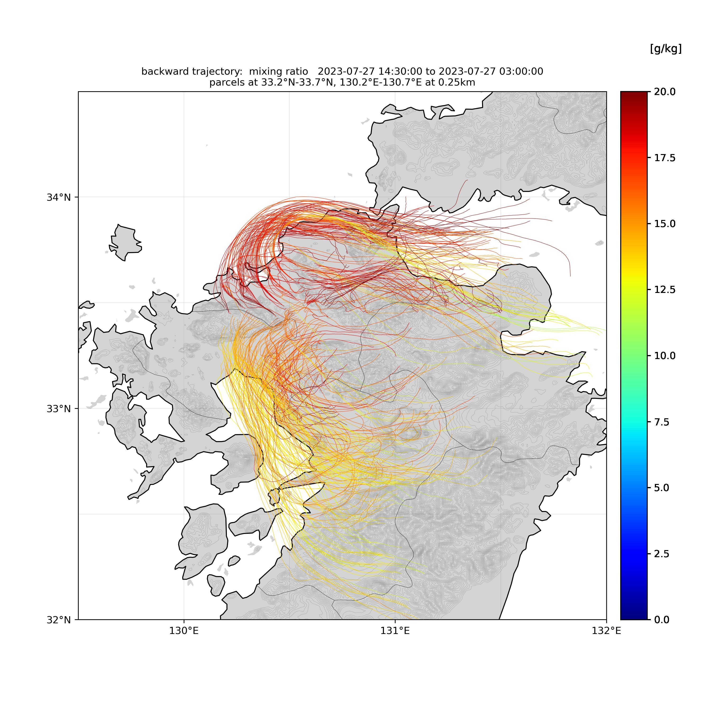
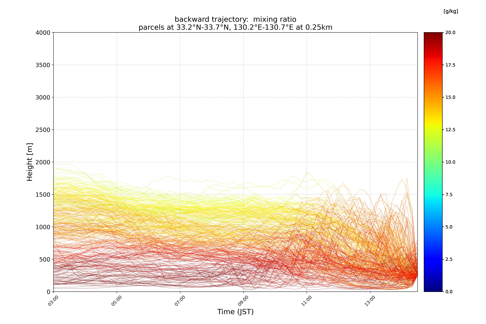
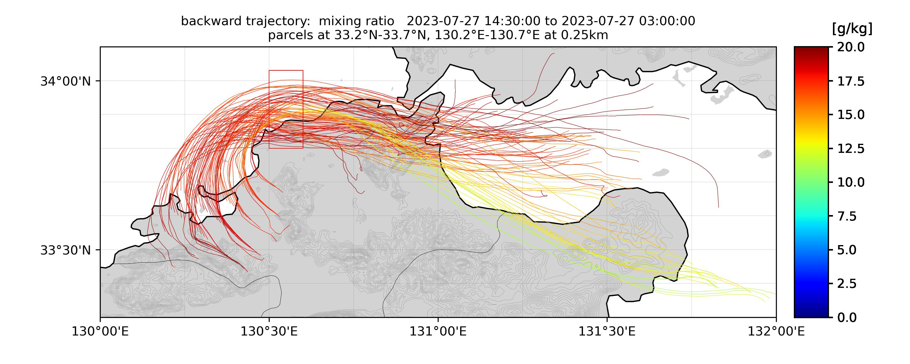
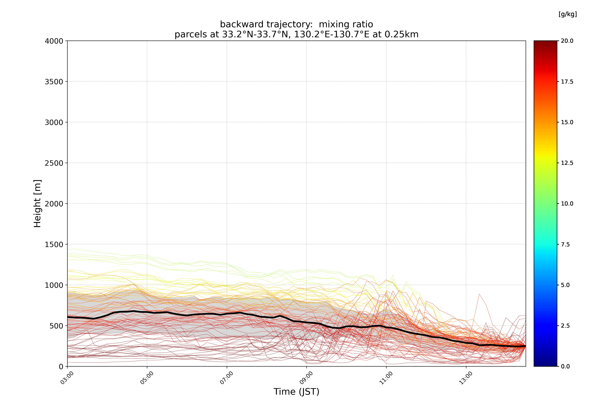

# RIP4 Trajectory Visualization

RIP4 による流跡線解析の結果を可視化します。




- フィルタリング機能と中央値線、四分位範囲プロット

  
  

## Feature

- RIP4 の backward/forward trajectory の流跡線を地図上に可視化します。
- 時間-高度図を作成して、流跡線の物理量の時間変化を可視化します。
- パーセルの物理量変化をカラーによって表現します。
- 指定のエリアを通過するパーセルのみをフィルタリングして描画することができます。
- オプションで全パーセルの中央値線と四分位範囲を引くことができます。

## 仮想環境

conda

```bash
conda env create -f env.yml
conda activate rip4
```

## Usage

1. `src/config/configuration.py`で描画する変数や範囲等を設定

2. `src/main.py`を実行して、画像を作成

   ```bash
   python src/main.py
   ```

作成された画像は `img`下に出力されます。

## Note

- 変数名は、`src/constant/variables.py`を参照してください。<br>
  パーセルを配置した矩形領域は正しく設定してください。図のタイトルおよびファイル名に反映されます。<br>

- エリアフィルタリングする際は trajectory 結果の time interval を考慮して、矩形領域を大きめに設定してください。フィルタリング無しの図上で線が領域内に入っていても、離散値である計算結果がちょうどその領域内に入っていないと描画されません。
